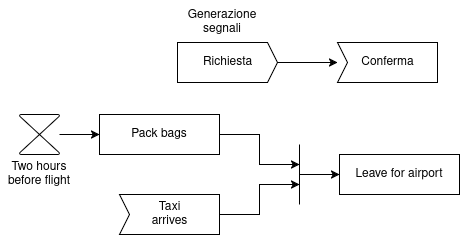
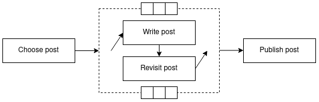
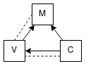
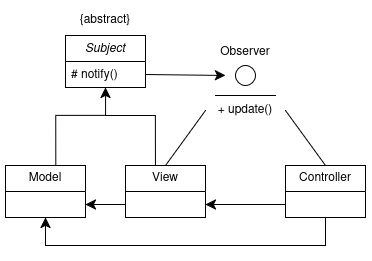
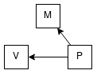
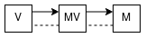

riccardo.cardin@unipd.it  
Accountability: siamo responsabili del nostro codice  
  
Ingegneria deve essere ripetibile  
Scelta strategica e non tattica, duratura  
  
Software factory 1968 (Nasa)  
1. CTO  
2. Analisi  
3. Sviluppo -ingegneri->  
4. Review, ritorna a 3. <-ingegneri-  
5. Produzione, ritorna a 1.  
6. User  
7. Bug, ritorna a 1.  
Dark factory, loop automatizzato  
  
Il problema di OOP è come definiamo gli oggetti. Le inheritance spesso sono da evitare.  
Dipendenza (coupling): A->B, al cambio di B è probabile che anche A deve cambiare. Sono da ridurre il più possibile (debito tecnico).  
> "Prefer Composition over Inheritance"  
  
- *Dipendenza (relation)*: quando un metodo di A è usato in qualche parte del codice di B. C'è una dipendenza sulla firma del metodo e lo scope è quello del metodo in cui è stato chiamato.  
- *Associazione*: quando B ha un parametro di tipo A. La dipendenza è su tutte le firme dei metodi di A e ha una scope di tutta la classe A.  
- *Aggregazione*: B è creato in A. Si deve gestire la sua creazione e la sua distruzione (composition).  
- *Ereditarietà*: il codice di A è condiviso a B  
  
I design pattern non sono volti a fornire soluzioni ma a definire meglio un problema e proporre una soluzione definendo pro e contro.  
  
## Diagrammi di Casi d'uso  
E' una delle metodologie. Un'altra sono le user story.  
  
Si usa l'**UML 2 (Unified Modeling Language)**  
Visuale, comprensibili anche da attori senza conoscenze tecniche.  
  
Individuare il dominio:  
	{::nomarkdown} <u>COSA</u> {:/nomarkdown} fa parte del *sistema*, tutto ciò su cui si ha responsabilità  
  
Un *attore* è fuori dal sistema ovvero non è sotto al controllo di esso. Egli interagisce con il sistema per accedere a delle funzionalità (*casi d'uso*). Gli attori hanno ruoli.  
  
A->B  
Precondizione A: stato del sistema prima dello scenario  
Postcondizione B: stato del sistema dopo l'avvenuta dello scenario principale  
  
IAM (Identity and Access Management)  
  
> **Specifica Use Case**  
> *Caso d'uso:* UC1 - Autenticazione  
> *Attore principale (attivo):* cliente non riconosciuto  
> *Precondizioni:* l'utente non è ancora autenticato presso il sistema  
>*Postcondizioni:* l'utente possiede un account presso il sistema distinto da un username e password  
> *Scenario principale:*   
> 1. L'utente accede al sistema  
> 2. L'utente inserisce l'username  
> 3. L'utente inserisce la password  
> *Estensioni:*  
> a. L'utente inserisce la password errata  
> 	1. L'utente non accede al sistema  
> 	2. Viene visualizzato errore di autenticazione  
  
Scenario alternativo: Autenticazione esterna  
Attore secondario: Google, passivo  
Per comunicare usano ubiquitous language da DDD.  
  
  
L'attore principale può avere diversi ruoli che accedono a diversi use case.  
  
Attenzione: non concentratevi sull'ui, separazione dei casi uso per funzionalità.  
  
## Diagrammi di Attività  
Concorrenza è caratteristica del problema, l'ordine non è predeterminato.  
Parallelismo è caratteristica del sistema (runtime). Contiene la concorrenza.  
  
  
Il diagramma deve essere mantenuto; non deve divergere dal codice.  
Una attività può avere un solo input, usare il join per unire il risultato di più attività.  
  
Si possono definire anche i pin parametri, ovvero gli input e gli output e le trasformazioni (fork del parametro). Poco usato.  
  
Quando le attività sono eseguite da attori con ruoli (responsabilità) diversi, si possono usare le *swimlanes*.  
  
Si possono modellare l'invio e la ricezione di segnali. Time signal per definire tempo di attesa.  
  
  
Regione di espansione  
- ripetizione di attività su una collezione  
- ogni elemento nella collezione è un token  
- solo un token in uscita  
  
  
  
## Diagrammi delle Classi  
Una classe è una descrizione. Un oggetto è la sua instanziazione.  
  
La sua precisione dipende da quanto valore fornisce.  
  
Individuare le classi e le loro proprietà (attributi, metodi).  
Attributo = $$O_{\text{scope}}$$ nome : tipo $$[*=>0...n,n\in\mathbb{N}^*]$$  
$$O_{\text{scope}}$$ può essere   
	+ pubblico, - privato  
	# protetto, ~ default  
Lo scope \# protetto e ~ default dipendono dal linguaggio di programmazione.  
  
Metodi = $$O_{\text{scope}}$$ nome (attr_nome : tipo) : tipo  
  
Una procedura non ha output. Da evitare.  
Una funzione ha output e non dovrebbe causare side-effect.  
  
  
Dipendenze   
$$\dashrightarrow$$ dipendenza semplice  
$$\rightarrow$$ associazione  
$$\lozenge\rightarrow$$ aggregazione; può essere condiviso  
$$\blacklozenge\rightarrow$$ composizione; non può essere condiviso  
$$\lhd-$$ ereditarietà, estensione  
  
Classi astratte non possono essere istanziate. Sono scritte in italico o {abstract}.  
  
Nei linguaggi ad oggetti evitare usare metodi statici pubblici.  
  
Interfaccia può avere solo dipendenza semplice o ereditarietà quando estende un'altra interfaccia.  
___ implementazione  
  
Una linea tratteggiata collegata a una associazione rappresenta una relazione. Non sono rappresentabili nei linguaggi di programmazione.  
  
  
\[T] per rappresentare tipi generici  
{::nomarkdown} <u>sottolineato</u> {:/nomarkdown} per metodi statici; meglio evitarli perché è difficile definire le dipendenze e non può essere sottomesso a unit test  
  
\<T extends E> type bound non può essere rappresentato in UML.  
  
## Design Pattern architetturali  
Un design pattern è un *glossario di problemi comuni* e le possibili soluzioni con pro e contro.  
  
Un design pattern architetturale definisce le dipendenze tra i componenti. Ci sono 5 tipi. Guidati da requisiti non funzionali.  
  
Secondo la legge di Conway, un software viene progettato rispecchiando i rapporti sociali nelle organizzazioni.  
### Architettura di tipo logico  
Programma back-end  
1. *Application Logic*  
   validazione sintattica delle applicazioni  
   adapting delle informazioni in oggetti usabili, {::nomarkdown} <u>DTO</u> {:/nomarkdown} (Data Transfer Objects)  
2. *Business Logic*  
   dominio applicativo per cui sto andando a sviluppare  
   validazione semantica o di {::nomarkdown} <u>dominio</u> {:/nomarkdown}  
3. *Persistent Logic*  
   ciò che va a comunicare con l'esterno e come vengono salvati  
   le classi che si scrivono sul database si chiamano {::nomarkdown} <u>entity</u> {:/nomarkdown}  
  
L'architettura di tipo logico definisce come queste tre logiche interagiscono con loro. Applicare il fail fast.  
  
**Layered Architecture**  
Agli inizi l'organizzazione aziendale era a piramide: diversi tier dipendenti con quelli sopra e centrati da un CEO. Non funziona in aziende con molti dipendenti.  
  
La relazione delle tre logiche è una in cui una dipende dall'altra  
$$\displaystyle{Application\atop \text{classi controller}}\rightarrow{Business\atop \text{classi service}}\rightarrow{Persistent\atop \text{repository}}$$  
  
Problema: la persistent logic è la più importante perché è la più vicina a quella fisica. Si inizia a strutturare l'architettura da questo strato.  
  
**Hexagonal Architecture**  
  
  
Controller -input-> Service ->Dominio<- Repository  
port-adapter  
  
Business logic è la più importante. Comunica con l'esterno tramite porte (driver). Gli adapting vengono fatte su queste e implementano gli use case.  
  
#### Pattern Model-View  
Pattern front-end  
E' una architettura di tipo logico perché l'unico deployment che fa sono sulla macchina del cliente.  
  
Programma front-end  
0. *Presentation Logic* (classe view)  
   presentazione grafica  
1. *Application Logic*  
2. *Business Logic* (classe model)  
   implementata da un modello  
  
View<>Model  
Si deve risolvere il problema di sincronizzazione tra vista e modello.  
Separation of concern, competenze per risolvere una logica  
  
**Model-View-Controller Pattern**  
(Observer Pattern)  
Controller: reazione agli input utente (application logic)  
  
  
  
View notifica il Controller quando l'utente ci interagisce  
Modello notifica la View quando è stato modificato  
  
Push Model, client side rendering  
  
  
Pull Model, server side rendering  
La view è separata per client e server  
  
**Model-View-Presenter Pattern**  
*Presenter (passive view)*  
- man in the middle  
- osserva il modello  
- View $${-\bullet\ \leftarrow\atop\longrightarrow}$$ Presenter -> Model  
  modello ritorna un valore al presenter  
- aggiorna e osserva la vista (dumb)  
  
  
  
View è solo un template di visualizzazione e un'interfaccia di comunicazione. Sostituibile da mock in test.  
  
**Model-View-ViewModel Pattern**  
*ViewModel*  
- proiezione del modello per una vista  
- binding con la vista e il modello  
View  
- dichiarativa  
- data-binding a due vie con proprietà del ViewModel  
- non possiede più lo stato dell'applicazione  
  
  
  
Framework ha il flusso che richiama gli elementi da noi definiti  
Libreria: il flusso è a mano nostra e richiamiamo elementi in libreria  
  
### Architettura di tipo deployment  
Basato sulla build, installazione del software.  
**Architettura monolite**  
E' composto da un monolite, detto anche artifact o installazione, indipendente dalle altre applicazioni. Da un monolite si definiscono i servizi.  
Scaling  
- verticale: capacità fisiche  
- orizzontale: duplicazione dei servizi  
  
Ha un problema di "big ball of mud" dove un solo monolite fatto male può portare a una serie di servizi fatti male.  
Per risolvere questo si può applicare il modular monolith.  
  
**Architettura a microservizi**  
E' un'architettura distribuita.  
  
La serie di microservizi sono indipendenti l'uno con l'altro con concetti di dominio separati.   
Si devono stabilire come i microservizi interagiscono tra loro.  
I microservizi *non possono condividere risorse* nel sistema di persistenza.  
  
La problematica dei microservizi è la rete.  
Da un sistema locale a un sistema distribuito: si perde la la proprietà di transazionalità (certezza che tutti i processi richiesti vengano eseguiti).  
  
CAP theorem = un sistema distribuito può assicurare solo due proprietà tra Consistency, Availability e Partitioned.  
Se tutte e tre sono assicurate dal sistema questa è ACID, ovvero ha la proprietà di transazionalità ed non è un sistema distribuito.  
Database sQL sono ACID.  
  
Domain Driven Design è riprodurre al livello software il dominio applicativo.   
  
Circuit breaker = definisce un circuit break nel caso di errore in un microservizio.  
Rate limiter = definisce un limite di traffico mandato da un microservizio.  
  
Idempotenza = gestione di dati duplicati.  
  
SemVer  
Semanthic Versioning stabilisce che ogni versione può essere  
- x Major, non retrocompatibile  
- y Minor, retrocompatibile  
- z Patch, piccole modifiche retrocompatibili  
  
*Topologie*  
API-based = una libreria che comunica con i microservizi  
REST-based = applicazione che comunica con i microservizi  
  
Con la comunicazione sincrona chi chiede deve rimanere in attesa attiva della risposta.  
Centralised Message = c'è un layer di message broker che attende e inoltra risposte  
  
### Dependency Injection  
E' l'uso di framework.  
Chiamo codice che risolve il problema di risoluzione delle dipendenze.  
  
Oggetto di dominio che modella la realtà. Codificato dal developer.  
Oggetto infrastrutturale che supportano. Usa un framework.  
  
Albero delle dipendenze, Direct Acyclic Graph  
  
La dipendenza non ha proprietà transazionali.  
  
```c++  
class A {  
	B b;    // Field injection  
	A(B b); // Constructor(Ctor) injection  
	void setB(B b); // Method injection  
}  
```  
  
Problema  
gli errori di dipendenza sono rilevabili solo in fase di esecuzione.  
  
Injector = risolve le dipendenze per conto mio, framework.  
  
@Inject per dichirare che le injections  
  
*Spring (in Java e Kotlin)*  
@Configuration, classe che specifica  
	@Bean definisce come costruire un oggetto  
  
```kotlin  
@Configuration  
open class CoffeeConfig {  
	@Bean  
	open fun movieRepository : FindMoviesByDirectorPort {  
		return MovieRepository()  
	}  
	  
	@Bean  
	open fun movieService (  
		port: FindMoviesByDirectorPort  
	) : FindMoviesByDirectorUseCase {  
		return MovieService(port)  
	}  
}  
  
fun main(args: Array<String>) {  
	runApplication<SwebdApplication>(*args)  
}  
```  
Aiutano a costruire un Context Map con oggetti costruiti e le loro dipendenze (singlets).  
  
Con il metodo tradizionale ci sono più copie diverse del codice in ambienti diversi.  
  
## Design Pattern Creazionali  
Design pattern per la creazione di istanze.  
### Builder  
Dobbiamo costruire oggetti complessi cioè si deve passare un grande numero di informazioni alla loro costruzione.  
Problemi  
- Telescoping: diversi costruttori da costruire e mantenere  
- è possibile passare valori non validi  
  
```kotlin  
class Movie (  
	private val title: String, //required  
	private val director: String, //required  
	private val year: Int?,  
	private val genre: String?,  
) {  
	constructor (  
		title: String, director: String  
	) : this(title, director, year=null, genre=null)  
	  
	/* molteplici varianti di costruttore con diversi null */  
	  
	class Builder {  
		private val title: String,  
		private val director: String,  
		private val year: Int? = null,  
		private val genre: String? = null,  
		  
		fun withTitle(title: String): Movie.Builder {   
			this.title = title  
			return this  
		}  
		fun withDirector(director: String) apply { this.director = director }  
		fun withYear(year: Int) apply { this.year = year }  
		fun withGenre(genre: String) apply { this.genre = genre }  
		  
		fun build() : Movie {  
			val title = requireNotNull(value=this.title) { "Title is required" }  
			val director = requireNotNull(value=this.director) { "Director is required" }  
			return Movie(title=title, director=director)  
		}  
	}  
}  
  
fun main() {  
	val movie = Movie.Builder()  
		.title("Backrooms")  
		.director("Kane Parsons")  
		.year(2026)  
		.build()  
}  
```  
  
Problema `Movie(title=director, director=title)`  
Primitive types blindness: le primitive non si differenziano dalla loro definizione.  
```kotlin  
@JvmInline  
value class Title(private val title: String) {  
	init {  
		require(value=title.isNotBlank()) { "Title cannot be blank" }  
	}  
}  
class Director(private val title: String) {}  
```  
Value Class hanno un solo attributo e vengono tradotti come primitive  
Stack per funzioni e primitive, Heap per indirizzazione  
  
### Singleton  
Assicurarsi l'esistenza di un'*unica istanza* di classe ed avere un *accesso globale* a questa.  
Motivazione: ci sono entità che non devono avere più di una istanza.  
Usato per classi service.  
  
  
  
```java  
public enum Singleton {  
	INSTANCE;  
	public void print();  
}  
```  
  
Problema: e' una variabile globale quindi ha dipendenza con tutto il codice. Usiamo i metodi di gestione di race condition e limitiamo il suo scope.  
  
Non è possibile effettuare i test con i Singleton.  
Nei caso non si vuole far in modo che il Singleton sia recuperabile ovunque, costruire un singleton classe con dipendenza esplicitata nel costruttore  
  
### Abstract Factory  
Fornisce una interfaccia per creare famiglie di prodotti senza specificare classi concrete.  
Motivazione:  
- Risulta una applicazione configurabile con diverse famiglie di componenti (es. toolkit grafico).   
- Ci sono classi astratte *factory* che definiscono le interfacce di creazione che vengono concretizzate e costruite una sola volta.  
  
```java  
public interface AbstractFactory {  
	Button buildButton();  
}  
  
class ConcreteFactory implements AbstractFactory {  
	@Override  
	public Button buildButton() {  
		return new ConcreteButton();  
	}  
}  
  
public static void main(String[] args) {  
	ConcreteFactory abFactory = new ConcreteFactory(args[0]);  
	final ConcreteButton button = abFactory.buildButton();  
}  
```  
  
## Design Pattern Strutturali  
  
### Adapter  
Permette di convertire l'interfaccia di una classe con un'altra.  
  
Class adapter  
Adapter eredita sia dal target e l'adaptee. Non viene spesso usata.   
  
Object adapter  
Adapter implementa target e compone l'adaptee.  
```java  
interface PerimeterCalculator { // libreria  
	double perimeter(Shape shape);  
}  
class Square {} // mia applicazione  
  
class PerimeterCalculatorAdapter implements PerimeterCalculatorTarget {  
	private final PerimeterCalculator delegate;  
	  
	@Override  
	double perimeter(Shape shape) {  
		if(shape instanceof Square) { /* uso in data-oriented */  
			Square square = (Square) shape;  
			return square.lato*4;  
		}  
	}  
}  
  
public static void main(String[] args) {  
	final PerimeterCalculatorTarget perimeterCalculator =  
		new PerimeterCalculatorAdapter(new PerimeterCalculator());  
	p  
}  
```  
  
### Decorator  
Si vogliono mantenere le funzionalità base ma aggiungere qualcosa prima o dopo.  
Funziona meglio quando la base non ha troppi metodi.  
Riduce le implementazioni ai diversi  
  
```java  
public abstract class PreToppedDecorator implements Pizza {  
	private final Pizza pizza;  
	  
	@Override  
	public List<String> ingredients() {  
		return toppingIngredient(pizza.ingredients());  
	}  
	  
	protected abstract List<String> toppingIngredients();  
}  
  
public static void main(String[] args) {  
	Pizza margherita = new TomatoPizza(  
		new MozzarellaCheesePizza(new BasePizza)  
	);  
}  
```  
  
### Facade  
Fornisce una interfaccia unica semplice per un sottosistema complesso. Struttura un sistema di sottosistemi.  
  
Può essere usato per nascondere il sottosistema e gestire le classi a cui il client può interagire.  
  
E' un single point of failure e complica le dipendenze: va utilizzato solo quando il client chiama almeno 2 classi SEMPRE.  
  
### Proxy  
E' un surrogato che condivide la stessa interfaccia della classe da mediare.  
  
  
- Remote Proxy, rappresentazione locale di un oggetto remoto  
- Virtual Proxy, oggetto viene costruito solo quando viene usato (on demand)  
- Protection Proxy, controllo degli accessi all'oggetto  
  
Es. smart pointer  
  
## Pattern comportamentali  
Permettono la definizione d  
### Command Pattern  
Definisce l'interfaccia per eseguirle una richiesta (oggetto)  
  
  
Gestisce richieste di cui non si conoscono i particolari  
Passare in input tutti parametri necessari  
Lambda, funzioni passate come parametri  
### Strategy Pattern  
Definisce una famiglia di algoritmi intercambiabili.  
  
  
Problema: non è detto che tutte le implementazioni hanno bisogno delle stesse informazioni, i metodi devono richiamare loro le informazioni aggiuntive di cui hanno bisogno  
  
### Template Method Pattern  
Fornisce un template del processo senza specificare il comportamento dei singoli  
  
  
```java  
public abstract class LoginManager {  
	protected validateInput(username, password);  
	protected authenticate(username, password);  
	public User login(String username, String password) {  
		validateInput(username, password);  
		authenticate(username, password);  
		return authorize(username);  
	}  
}  
```  
  
Problema: è un pattern che si basa sull'estensione, è buono finché non permette override  
### Iterator  
Fornisce l'accesso sequenziale a un aggregato.  
Abstract  
  
L'iteratore può essere esterno (attivo) dove l'utente controlla l'iterazione o interno (passivo) dove è controllato dall'iteratore stesso.  
  
## SOLID Principles  
- Single Responsibility principle  
- Open-Close principle  
- Liskov Substitution principle  
- Interface Segregation principle  
- Dependency Inversion principle  
  
**Single Responsibility principle** (coesione)  
Un oggetto deve avere una singola responsabilità ovvero, tutti i suoi client devono usare tutti i suoi metodi.  
  
Problema: crea una dipendenza transitiva difficilmente tracciabile.  
  
**Open-Close principle**  
Il metodo deve essere aperto alle estensioni ma chiuso alle modifiche.   
I programmi che seguono questo principio non subiscono "cascade of changes".  
es. Polimorfismo  
  
**Liskov Substitution principle**  
Funzioni che usano puntatori e riferimenti nella classe base devono poter usare oggetti dalle classi derivate senza saperlo.  
  
Evitare override di un metodo concreto pubblico.  
  
Design by contract: definire le pre e post definizioni dove la pre-condizione delle classi derivate devono essere più lasche della classe base mentre la post-condizione devono essere più forte.  
  
**Interface Segregation principle**  
La riduzione di accoppiamento significa dipendere dalle interfacce e non dalle implementazioni.   
Problema: implementazioni non danno errori, sono più difficili da trovare  
